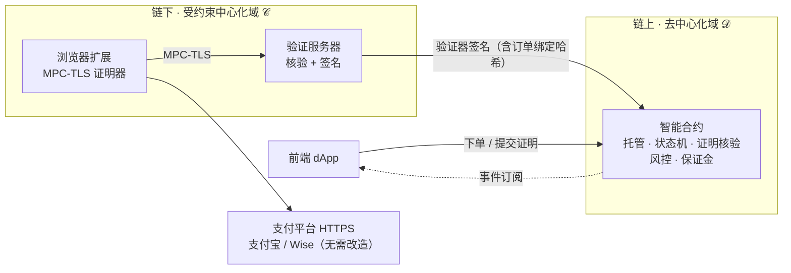

<div align="center">

<picture>
  <source media="(prefers-color-scheme: dark)" srcset="docs/assets/brand/banner-dark.svg">
  
</picture>

### 半去中心化 C2C 法币 ↔ 加密货币兑换协议

**把链下支付（支付宝 / Wise 转账）变成链上合约可直接核验的密码学证明。**<br>
<sub><i>Turn off-chain Alipay / Wise payments into on-chain-verifiable cryptographic proofs.</i></sub>

<p>
  
  
  
  
  
</p>

<p>
  <a href="docs/zh/hands-on/01-quickstart.md"><b>🚀 快速上手</b></a> ·
  <a href="docs/zh/README.md"><b>📚 中文文档</b></a> ·
  <a href="docs/en/README.md"><b>📖 English Docs</b></a> ·
  <a href="docs/zh/thesis.md"><b>📄 论文信息</b></a>
</p>

</div>

> [!NOTE]
> 硕士论文配套开源实现。文档所有事实以**实际代码与源数据**为准，代码引用均写 `文件:行号`，可点击核对。

## 📊 关键数字

<table>
  <tr>
    <td align="center" width="25%"><h3>≈ &#36;0.13</h3><sub>单笔完整换汇链上成本<br>Arbitrum One 均值档</sub></td>
    <td align="center" width="25%"><h3>5.94 s</h3><sub>支付宝端到端（理想）<br>宽带 17.44 s</sub></td>
    <td align="center" width="25%"><h3>9.74 s</h3><sub>Wise 端到端（理想）<br>宽带 24.02 s</sub></td>
    <td align="center" width="25%"><h3>336 / 0</h3><sub>合约测试 通过 / 失败<br>实跑于 2026-06-02</sub></td>
  </tr>
</table>

> [!IMPORTANT]
> 数字均回源数据（CSV / 测试输出 / 合约常量）现场复算，过程见 [评估篇](docs/zh/deep-dive/06-evaluation.md)。

## 🎯 这是什么

一套让 **链下法币支付事实被链上智能合约直接、密码学地验证** 的 C2C 兑换协议。链下用 MPC-TLS（TLSNotary）生成支付证明，验证服务器签名后在链上核验；资产托管与订单状态在链上确定性执行。

<table>
  <tr>
    <td width="50%" valign="top">
      <h4>① 订单绑定哈希</h4>
      把链下证明与链上订单密码学绑定，防证明跨单复用 / 篡改。
    </td>
    <td width="50%" valign="top">
      <h4>② 半去中心化双域架构</h4>
      链上去中心化执行 + 链下受约束公证。
    </td>
  </tr>
</table>

## 🏗 架构一览



<details>
<summary><b>📈 实验数据：支付宝 vs Wise 端到端耗时</b>（点击展开）</summary>
<br>
<p align="center">
  
</p>
<p align="center"><sub>图中 Wise 取每次运行两个并行证明的较大值后再求中位数（理想 9.9 s），上方指标卡沿用论文口径：两个证明各自求中位数后取较大值（9.74 s）。<br>更多图表与复算过程见 <a href="docs/zh/deep-dive/06-evaluation.md">评估篇</a>。</sub></p>
</details>

## 🧭 选择你的路径

| 我想… | 从这里开始 |
|---|---|
| 🚀 跑起来 | [快速上手](docs/zh/hands-on/01-quickstart.md) → [Demo 走查](docs/zh/hands-on/02-demo-walkthrough.md) |
| 🧠 读懂协议 | [深度轨总览](docs/zh/deep-dive/01-overview.md) → [协议设计](docs/zh/deep-dive/04-protocol-design.md) → [安全分析](docs/zh/deep-dive/05-security-analysis.md) |
| 📚 对照源码 | [源码地图](docs/zh/reference/code-map.md) · [合约参考](docs/zh/reference/contracts.md) |
| 📄 了解论文 | [论文信息](docs/zh/thesis.md) |

## 🗂 仓库结构

```text
.
├── tlsn-extension/          # 子模块：C2C 协议实现（合约 · 验证服务器 · Keeper · dApp）
├── tlsn-0.1.0-alpha.14/     # 上游 TLSNotary 快照（未修改）
├── data_analysis/           # 实验原始数据（CSV）与图表脚本
└── docs/                    # 中英文档：hands-on / deep-dive / reference
```

## 🙏 致谢与归属

构建于 [tlsnotary/tlsn-extension](https://github.com/tlsnotary/tlsn-extension)（TLSNotary / PSE 团队）之上，C2C 协议层为本文贡献。详见 [归属与许可](docs/zh/ATTRIBUTION.md)。

---

<details>
<summary><b>🌐 English overview</b></summary>
<br>

> [!NOTE]
> 📖 Full English documentation: **[docs/en/README.md](docs/en/README.md)** (mirrors the Chinese set).

**What is this?** A C2C fiat ↔ crypto exchange protocol that lets **on-chain smart contracts directly and cryptographically verify off-chain payment facts**. Off-chain payments (Alipay / Wise) are proven via MPC-TLS (TLSNotary), signed by a verifier server, and verified on-chain; asset custody and order state execute deterministically on-chain.

**Contributions:** an **order-binding hash** (prevents cross-order proof reuse / tampering) and a **semi-decentralized dual-domain architecture** (decentralized on-chain execution + constrained off-chain notarization).

**Key numbers:** ≈ \$0.13 on-chain cost per complete exchange (Arbitrum One, mean tier); end-to-end latency 5.94 s / 9.74 s (Alipay / Wise, ideal); contract tests 336 passing (live run, 2026-06-02).

**License:** Apache-2.0 OR MIT. Built on [tlsnotary/tlsn-extension](https://github.com/tlsnotary/tlsn-extension); C2C protocol layer © 2026 looikaizhi. See [ATTRIBUTION](docs/en/ATTRIBUTION.md).

</details>
