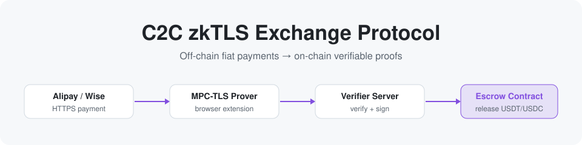

<picture>
  <source media="(prefers-color-scheme: dark)" srcset="../assets/brand/banner-dark.svg">
  
</picture>

# Protocol Docs · English Navigation

**A TLSNotary-based zkTLS semi-decentralized C2C fiat ↔ crypto exchange protocol**

[🚀 Quickstart](hands-on/01-quickstart.md) · [🧠 Deep-dive](deep-dive/01-overview.md) · [📚 Source map](reference/code-map.md) · [🌐 中文](../zh/README.md)

---

> [!NOTE]
> Open-source documentation accompanying a master's thesis. All facts follow the **actual code and source data**; code references are written as `file:line` and are clickable.

## ⏱ In 30 seconds

**The pain point**: in fiat ↔ crypto C2C exchange, the off-chain payment fact (an Alipay/Wise transfer) **cannot be directly verified by an on-chain contract**, so it can only rely on centralized-platform custody + manual arbitration.

**The solution**: off-chain, **MPC-TLS (TLSNotary)** turns the payment fact into a cryptographic proof; after the verifier server signs it, it is **verified directly inside the on-chain contract**, with asset custody and order state executed deterministically on-chain. Two innovations: ① an **order-binding hash** that cryptographically binds the off-chain proof to the on-chain order (preventing cross-order reuse/tampering); ② a **semi-decentralized dual-domain architecture** (decentralized on-chain execution + constrained off-chain notarization).

---

## 🎯 The gap it fills: three properties at once

This scheme is the only one of the mainstream routes that **achieves all three properties while supporting fiat exchange** (thesis ch2 comparison):

| Property | Centralized exchange | P2P OTC | On-chain DEX+oracle | **This work** |
|---|:---:|:---:|:---:|:---:|
| Supports fiat exchange | ✓ | ✓ | ✗ | **✓** |
| Trustless asset custody | ✗ | ✗ | ✓ | **✓** |
| Cryptographically verifiable payment proof | ✗ | ✗ | N/A | **✓** |
| On-chain account-identifier privacy | ✗ | ✗ | N/A | **✓** |

> [!NOTE]
> The cost: a weak trust in the verifier server + limited single-point-of-failure resistance under the current single node — the engineering trade-off of semi-decentralization.

---

## 🧭 Choose your path

<table>
  <tr>
    <th width="33%">🚀 Hands-on want to run it</th>
    <th width="34%">🧠 Deep dive want to understand it</th>
    <th width="33%">📚 Reference look things up</th>
  </tr>
  <tr>
    <td valign="top">

1. [Quickstart](hands-on/01-quickstart.md) minimal local loop, zero real accounts
2. [Demo walkthrough](hands-on/02-demo-walkthrough.md) five steps of a real exchange
3. [Troubleshooting](hands-on/03-troubleshooting.md) error reference + FAQ

</td>
    <td valign="top">

1. [Overview](deep-dive/01-overview.md) ⭐ protocol panorama & reading map
2. [zkTLS & TLSNotary](deep-dive/02-zktls-tlsnotary.md) the cryptographic foundation
3. [Threat model](deep-dive/03-threat-model.md) why it is designed this way (T1–T5)
4. [Protocol design](deep-dive/04-protocol-design.md) ⭐ system design & two innovations
5. [Security analysis](deep-dive/05-security-analysis.md) the S1–S5 security argument
6. [Evaluation](deep-dive/06-evaluation.md) measured Gas / latency data

</td>
    <td valign="top">

- [Source map](reference/code-map.md) ⭐ thesis concept ↔ source location
- [Contracts](reference/contracts.md) interfaces / events / permissions
- [Verifier & plugins](reference/verifier-plugin.md) extensibility, new platforms
- [Glossary](reference/glossary.md) term lookup
- [Thesis info](thesis.md) · [Attribution](ATTRIBUTION.md)

</td>
  </tr>
</table>

---

## 📊 Key numbers

<table>
  <tr>
    <td align="center" width="25%"><h3>≈ &#36;0.13</h3>on-chain cost per exchange Arbitrum One, mean tier</td>
    <td align="center" width="25%"><h3>5.94 s</h3>Alipay end-to-end (ideal) broadband 17.44 s</td>
    <td align="center" width="25%"><h3>9.74 s</h3>Wise end-to-end (ideal) broadband 24.02 s</td>
    <td align="center" width="25%"><h3>336 / 0</h3>contract tests pass / fail live run</td>
  </tr>
</table>

> [!IMPORTANT]
> For the recomputation process, see [deep-dive/06-evaluation.md](deep-dive/06-evaluation.md).

---

📑 <b>Thesis chapter ↔ document map</b> (click to expand)

| Document | Main thesis source |
|---|---|
| [deep-dive/01-overview](deep-dive/01-overview.md) | abstract, ch1.3, ch4.1 |
| [deep-dive/02-zktls-tlsnotary](deep-dive/02-zktls-tlsnotary.md) | ch2.2–2.4 |
| [deep-dive/03-threat-model](deep-dive/03-threat-model.md) | ch3.1, ch3.5, ch3.6 |
| [deep-dive/04-protocol-design](deep-dive/04-protocol-design.md) | ch4.1–4.6 |
| [deep-dive/05-security-analysis](deep-dive/05-security-analysis.md) | ch4.7, ch4.8 |
| [deep-dive/06-evaluation](deep-dive/06-evaluation.md) | ch6 + `data_analysis/` |
| [reference/contracts](reference/contracts.md) | ch4.2, `packages/contracts` |
| [reference/verifier-plugin](reference/verifier-plugin.md) | ch4.3, ch4.4, `verifier`+`plugin-sdk` |
| [reference/code-map](reference/code-map.md) | ch4, ch5, the whole monorepo |
| [hands-on/*](hands-on/01-quickstart.md) | ch5, README, demo/keeper |

